# 社区维修平台

> 🎓 **计算机毕业设计 · 社区维修平台**
>
> 本仓库只放**项目介绍 + 运行截图**（截图是站点带水印的原图，存在仓库 `images/` 里）。
>
> 👉 **完整可运行源码 / 数据库脚本 / 部署文档：[点我获取](https://geekcode.top/archives/%E7%A4%BE%E5%8C%BA%E7%BB%B4%E4%BF%AE%E5%B9%B3%E5%8F%B0?utm_source=github)**
>
> 💬 咨询微信：**ir9372**　|　🌐 更多项目：[极客代码 geekcode.top](https://geekcode.top/?utm_source=github)
>
> 📌 项目详情页：<https://geekcode.top/archives/%E7%A4%BE%E5%8C%BA%E7%BB%B4%E4%BF%AE%E5%B9%B3%E5%8F%B0?utm_source=github>

<table><td width="230" align="center"> <b>扫码加微信 ir9372</b></td><td valign="middle">📦 源码 = 项目介绍 + 全部运行截图 + 数据库 + 部署文档 👉 点上方任意截图，直接跳到 <b>极客代码 geekcode.top</b> 详情页</td></table>

---

<h1>社区维修平台</h1>
<h2>项目概述</h2>

社区维修平台旨在解决传统社区维修服务中信息不对称、流程不透明及沟通效率低下的问题。该项目采用前后端分离架构，构建了一个集用户报修、工单管理、维修工接单、在线沟通及资讯发布于一体的综合服务平台。核心功能涵盖维修订单的全生命周期管理（创建、接单、完成）、社区公告与新闻资讯的推送、以及住户与维修工的互动反馈。适用人群包括社区住户、注册维修工及平台管理员。技术架构基于 Spring Boot 后端框架与 Vue 前端界面，通过 MyBatis-Plus 实现高效数据持久化，并利用 Shiro 框架保障系统的安全性与权限控制，实现了业务逻辑与展示层的解耦，提升了系统的可维护性与扩展性。

<h2>技术架构</h2>

本项目采用经典的 B/S 架构，分为前台用户交互层和后台管理服务层。

<strong>后端技术栈：</strong>

<ul>
<li><strong>核心框架</strong>：使用 Spring Boot 作为基础框架，利用其自动配置特性简化开发流程，快速搭建 RESTful API 服务。</li>
<li><strong>持久层</strong>：集成 MyBatis-Plus，在 MyBatis 的基础上提供了通用的 CRUD 操作接口，大幅减少 SQL 编写工作量，同时支持复杂查询优化。数据库选用 MySQL，存储用户信息、订单详情、公告内容等结构化数据。</li>
<li><strong>安全框架</strong>：引入 Apache Shiro，负责身份认证（Authentication）和授权（Authorization），确保不同角色（如普通用户、维修工、管理员）只能访问其权限范围内的资源。</li>
<li><strong>其他依赖</strong>：包含 <code>spring-boot-starter-web</code> 处理 HTTP 请求，<code>mysql-connector-java</code> 用于数据库连接，<code>commons-lang3</code> 提供通用工具类支持。</li>
</ul>

<strong>前端技术栈：</strong>

<ul>
<li>采用 Vue.js 框架构建单页面应用（SPA），实现前后端分离。前台面向住户和维修工，提供简洁直观的交互界面；后台面向管理员，提供数据可视化与管理功能。</li>
</ul>

<strong>数据库设计要点：</strong>

<ul>
<li>主要实体表包括：用户表（区分角色）、维修工表、维修订单表、接单信息表、社区公告表、新闻资讯表、留言反馈表、举报信息表及配置文件表。</li>
<li>表之间通过外键或业务关联字段建立联系，例如订单表关联住户 ID 与维修工 ID，确保业务流程的数据一致性。</li>
</ul>
<h2>功能模块</h2>
<h3>前台用户端</h3>

前台主要服务于社区住户和维修工，侧重于信息的获取与业务的发起。

<ol>
<li><strong>用户认证模块</strong>：</li>
</ol>
<ul>
<li><strong>登录/注册</strong>：支持新用户注册账号，老用户凭账号密码登录。根据截图显示，前台具备独立的登录与注册页面。</li>
</ul>
<ol start="2">
<li><strong>资讯浏览模块</strong>：</li>
</ol>
<ul>
<li><strong>社区公告</strong>：展示由管理员发布的社区通知、政策变动或紧急提醒。</li>
<li><strong>新闻资讯</strong>：提供行业动态、生活小贴士等非强制性阅读内容。</li>
</ul>
<ol start="3">
<li><strong>维修业务模块</strong>：</li>
</ol>
<ul>
<li><strong>维修订单列表</strong>：用户可查看自己发起的历史订单状态，或维修工查看待处理/已处理的订单。</li>
<li><strong>维修工信息</strong>：展示入驻平台的维修工资质、服务项目及联系方式，供住户参考选择。</li>
</ul>
<ol start="4">
<li><strong>个人中心</strong>：</li>
</ol>
<ul>
<li>用户可查看个人资料，管理个人信息设置。</li>
</ul>
<h3>后台管理端</h3>

后台主要服务于平台管理员，侧重于数据的全面管控与系统配置。

<ol>
<li><strong>基础信息管理</strong>：</li>
</ol>
<ul>
<li><strong>住户管理</strong>：查看、编辑或删除注册用户信息。</li>
<li><strong>维修工管理</strong>：审核维修工资格，管理维修工档案。</li>
</ul>
<ol start="2">
<li><strong>业务流程监控</strong>：</li>
</ol>
<ul>
<li><strong>维修订单管理</strong>：查看所有订单详情，追踪订单进度，处理异常订单。</li>
<li><strong>接单信息管理</strong>：监控维修工的接单行为，确保服务响应及时性。</li>
<li><strong>订单信息管理</strong>：对订单产生的具体数据进行精细化维护。</li>
</ul>
<ol start="3">
<li><strong>内容与沟通管理</strong>：</li>
</ol>
<ul>
<li><strong>社区公告管理</strong>：发布、修改、删除社区公告。</li>
<li><strong>新闻资讯管理</strong>：维护新闻栏目内容。</li>
<li><strong>留言板管理</strong>：查看并回复用户的留言反馈，处理投诉建议。</li>
<li><strong>在线沟通管理</strong>：监控用户与维修工之间的即时通讯记录。</li>
<li><strong>举报信息管理</strong>：接收并处理用户对不良行为的举报。</li>
</ul>
<ol start="4">
<li><strong>系统配置</strong>：</li>
</ol>
<ul>
<li><strong>配置文件管理</strong>：修改系统参数，如轮播图设置、站点名称等全局配置。</li>
</ul>
<h2>用户角色与权限</h2>

根据系统路由和控制器分布，平台主要存在以下三类角色，其权限划分如下：

<table>
<thead>
<tr>
<th align="left">角色</th>
<th align="left">描述</th>
<th align="left">可访问的功能模块</th>
</tr>
</thead>
<tbody><tr>
<td align="left"><strong>普通用户 (住户)</strong></td>
<td align="left">社区内的居民，需求方</td>
<td align="left">1. <strong>个人中心</strong>：查看/修改个人信息。2. <strong>社区公告</strong>：浏览公告。3. <strong>新闻资讯</strong>：浏览新闻。4. <strong>维修订单</strong>：创建订单、查看自己的订单列表。5. <strong>留言反馈</strong>：提交留言。6. <strong>维修工</strong>：浏览维修工列表。</td>
</tr>
<tr>
<td align="left"><strong>维修工</strong></td>
<td align="left">提供服务的专业人员</td>
<td align="left">1. <strong>个人中心</strong>：查看/修改个人信息。2. <strong>维修订单</strong>：查看指派给自己的订单。3. <strong>接单信息</strong>：执行接单操作，更新接单状态。4. <strong>社区公告/新闻</strong>：浏览相关信息。5. <strong>留言反馈</strong>：可能涉及与服务相关的反馈查看（视具体业务逻辑而定，通常侧重接单）。</td>
</tr>
<tr>
<td align="left"><strong>管理员</strong></td>
<td align="left">平台运营与维护人员</td>
<td align="left">拥有后台所有路由权限：1. <strong>住户管理</strong> (<code>/zhuhu</code>)：增删改查用户。2. <strong>维修工管理</strong> (<code>/weixiugong</code>)：增删改查维修工。3. <strong>维修订单管理</strong> (<code>/weixiudingdan</code>)：全量订单监控。4. <strong>接单信息管理</strong> (<code>/jiedanxinxi</code>)：监控接单行为。5. <strong>订单信息管理</strong> (<code>/dingdanxinxi</code>)：订单数据维护。6. <strong>社区公告管理</strong> (<code>/shequgonggao</code>)：发布/管理公告。7. <strong>新闻资讯管理</strong> (<code>/news</code>)：发布/管理新闻。8. <strong>留言板管理</strong> (<code>/messages</code>)：处理用户反馈。9. <strong>在线沟通管理</strong> (<code>/zaixiangoutong</code>)：查看聊天记录。10. <strong>举报信息管理</strong> (<code>/jubaoxinxi</code>)：处理违规举报。11. <strong>配置文件管理</strong> (<code>/config</code>)：系统参数设置。</td>
</tr>
</tbody></table>

<em>注：Shiro 框架将依据上述角色进行细粒度的 URL 拦截和方法级权限校验。</em>

<h2>项目特色与创新点</h2>
<ol>
<li>
<strong>全流程闭环管理</strong>：
   项目不仅涵盖了传统的“信息发布”和“订单创建”，还深入到了“接单”、“在线沟通”和“举报反馈”环节。通过 <code>/jiedanxinxi</code>（接单信息）和 <code>/zaixiangoutong</code>（在线沟通）模块，实现了从需求发起到服务交付再到售后评价的完整业务闭环，相比简单的报修系统更具实战意义。

</li>
<li>
<strong>多维度的信任机制</strong>：
   引入了 <code>/jubaoxinxi</code>（举报信息）和 <code>/messages</code>（留言反馈）模块。这不仅允许用户对服务质量进行监督，也为平台管理员提供了处理纠纷的依据，构建了基于社区口碑的信任体系，有助于提升维修工的服务质量。

</li>
<li>
<strong>灵活的内容分发策略</strong>：
   将“社区公告”与“新闻资讯”分离管理。公告侧重于强时效性的行政或服务通知，新闻侧重于软性知识传播。这种分类使得信息触达更加精准，避免了重要通知被娱乐性内容淹没。

</li>
<li>
<strong>基于 Shiro 的安全隔离</strong>：
   利用 Shiro 实现严格的 RBAC（基于角色的访问控制）。前台用户无法直接调用后台管理接口，后台管理员也无法随意篡改普通用户的隐私数据（除非在特定管理权限下），确保了数据的安全性和系统的稳定性。

</li>
</ol>
<h2>部署环境</h2>

为确保项目正常运行，需准备以下软件环境：

<ol>
<li><strong>JDK 版本</strong>：建议 JDK 1.8 及以上版本（Spring Boot 2.x 兼容性好）。</li>
<li><strong>数据库</strong>：MySQL 5.7 或 MySQL 8.0。需安装 MySQL Server 并创建对应数据库实例。</li>
<li><strong>构建工具</strong>：Maven 3.6+，用于管理 Java 依赖和项目打包。</li>
<li><strong>Node.js 环境</strong>：建议 Node.js 14.x 或更高版本，配合 npm 或 yarn，用于编译和运行 Vue 前端项目。</li>
<li><strong>Web 服务器</strong>：</li>
</ol>
<ul>
<li>开发阶段可使用内置 Tomcat（Spring Boot 自带）。</li>
<li>生产阶段建议使用 Nginx 进行静态资源托管和反向代理。</li>
</ul>
<ol start="6">
<li><strong>IDE 推荐</strong>：IntelliJ IDEA（后端）和 VS Code（前端）。</li>
</ol>
<h2>五、技术特性</h2>
<ul>
<li>前后端集成部署，前端资源打包至后端 static 目录</li>
<li>使用 MyBatis-Plus 简化数据访问层开发</li>
<li>集成 Shiro 权限框架实现角色权限控制</li>
</ul>
<h2>六、功能模块截图</h2>
<h3>前台用户端</h3>
<h4>前台登录页</h4>

<a href="https://geekcode.top/archives/%E7%A4%BE%E5%8C%BA%E7%BB%B4%E4%BF%AE%E5%B9%B3%E5%8F%B0?utm_source=github" title="查看完整源码">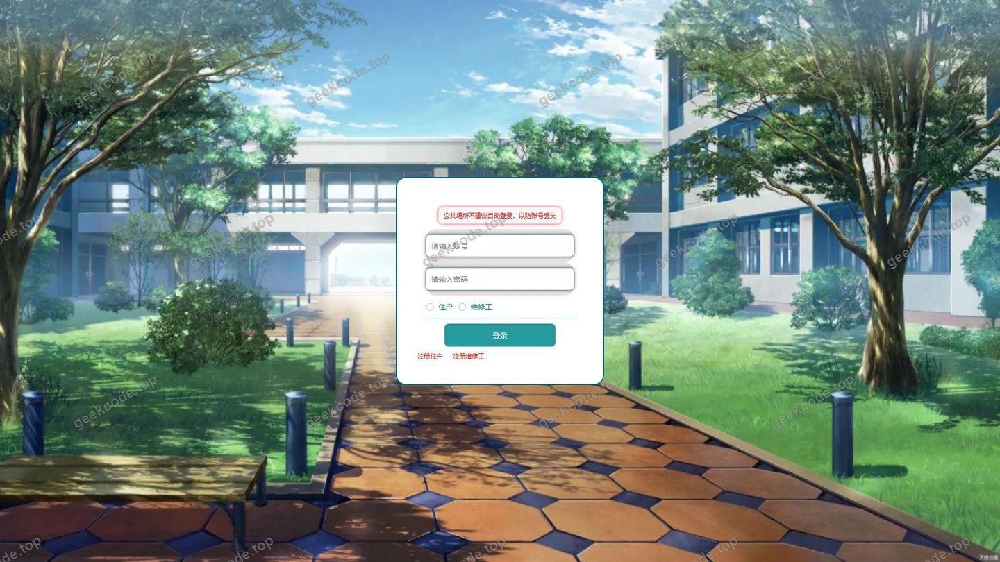</a>

<h4>前台注册页</h4>

<a href="https://geekcode.top/archives/%E7%A4%BE%E5%8C%BA%E7%BB%B4%E4%BF%AE%E5%B9%B3%E5%8F%B0?utm_source=github" title="查看完整源码">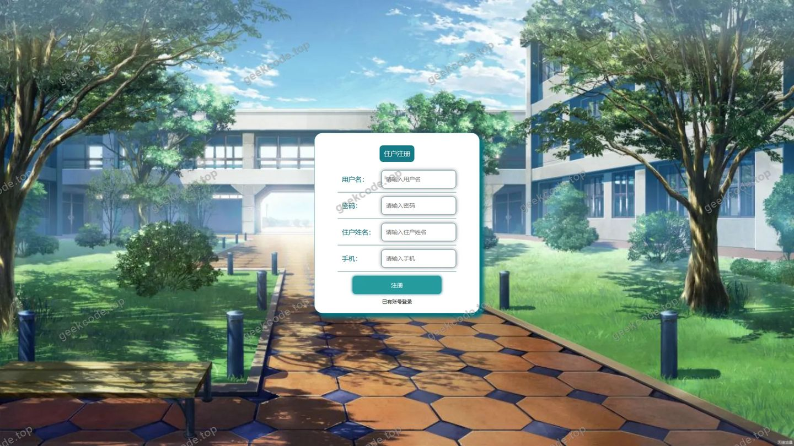</a>

<h4>前台-新闻资讯列表</h4>

<a href="https://geekcode.top/archives/%E7%A4%BE%E5%8C%BA%E7%BB%B4%E4%BF%AE%E5%B9%B3%E5%8F%B0?utm_source=github" title="查看完整源码">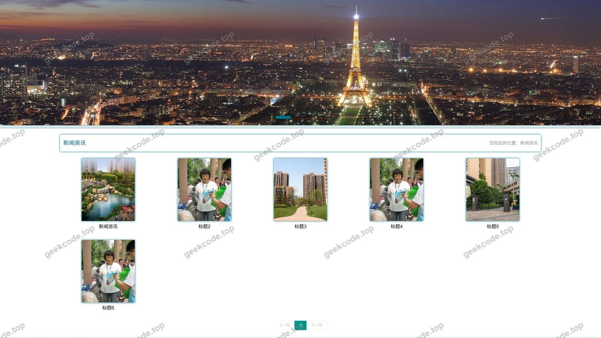</a>

<h4>前台-社区公告列表</h4>

<h4>前台-维修订单列表</h4>

<a href="https://geekcode.top/archives/%E7%A4%BE%E5%8C%BA%E7%BB%B4%E4%BF%AE%E5%B9%B3%E5%8F%B0?utm_source=github" title="查看完整源码">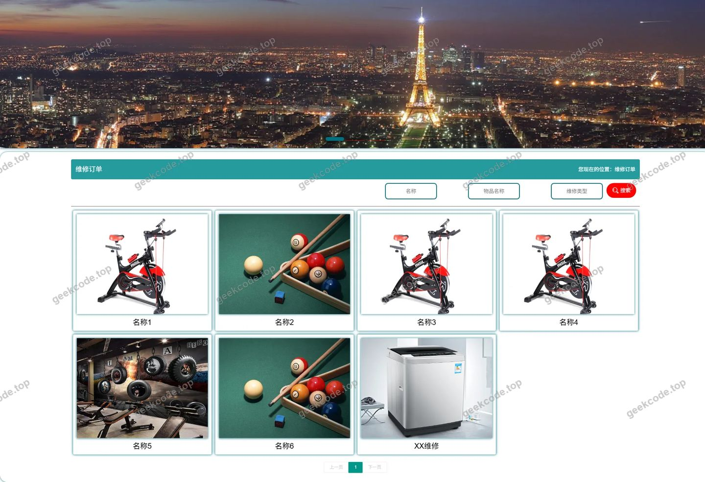</a>

<h3>后台管理端</h3>
<h4>后台-系统配置</h4>

<a href="https://geekcode.top/archives/%E7%A4%BE%E5%8C%BA%E7%BB%B4%E4%BF%AE%E5%B9%B3%E5%8F%B0?utm_source=github" title="查看完整源码">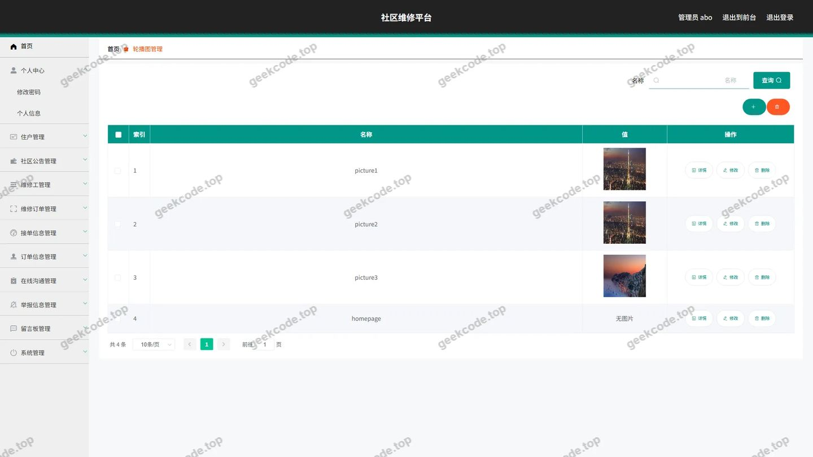</a>

<h4>后台-订单信息</h4>

<a href="https://geekcode.top/archives/%E7%A4%BE%E5%8C%BA%E7%BB%B4%E4%BF%AE%E5%B9%B3%E5%8F%B0?utm_source=github" title="查看完整源码">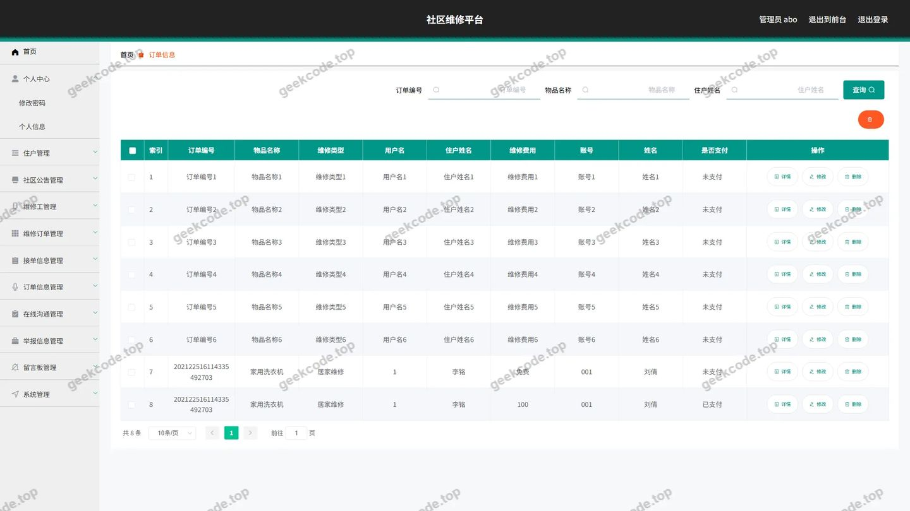</a>

<h4>后台首页</h4>

<a href="https://geekcode.top/archives/%E7%A4%BE%E5%8C%BA%E7%BB%B4%E4%BF%AE%E5%B9%B3%E5%8F%B0?utm_source=github" title="查看完整源码">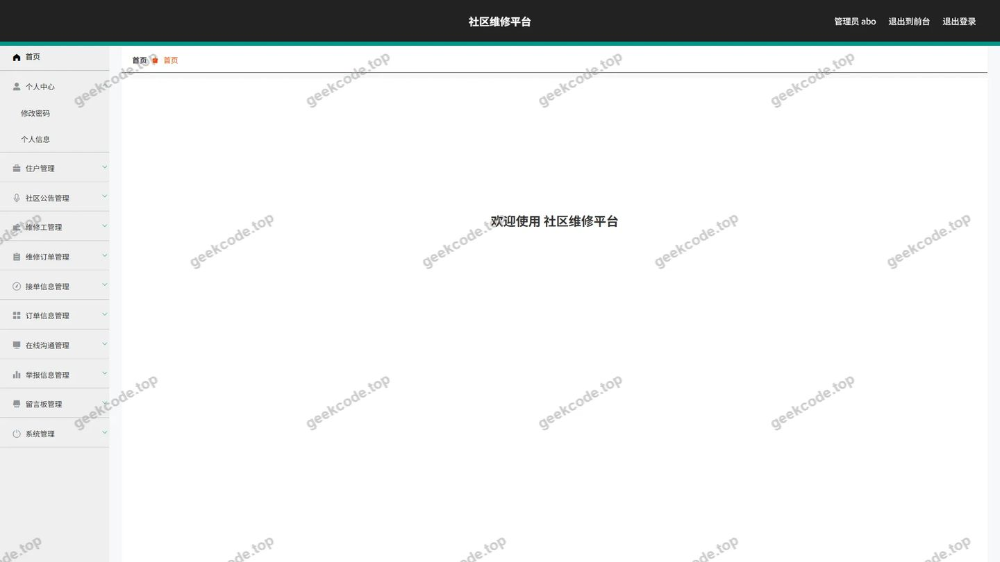</a>

<h4>后台-接单信息</h4>

<a href="https://geekcode.top/archives/%E7%A4%BE%E5%8C%BA%E7%BB%B4%E4%BF%AE%E5%B9%B3%E5%8F%B0?utm_source=github" title="查看完整源码">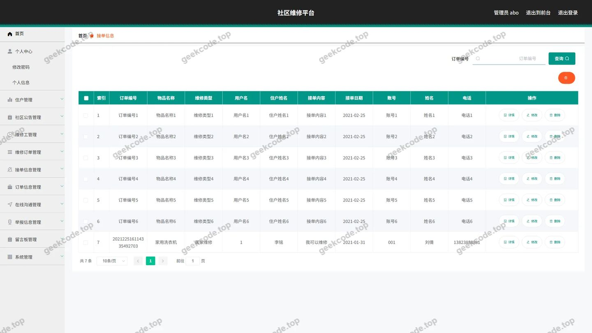</a>

<h4>后台-举报信息</h4>

<a href="https://geekcode.top/archives/%E7%A4%BE%E5%8C%BA%E7%BB%B4%E4%BF%AE%E5%B9%B3%E5%8F%B0?utm_source=github" title="查看完整源码">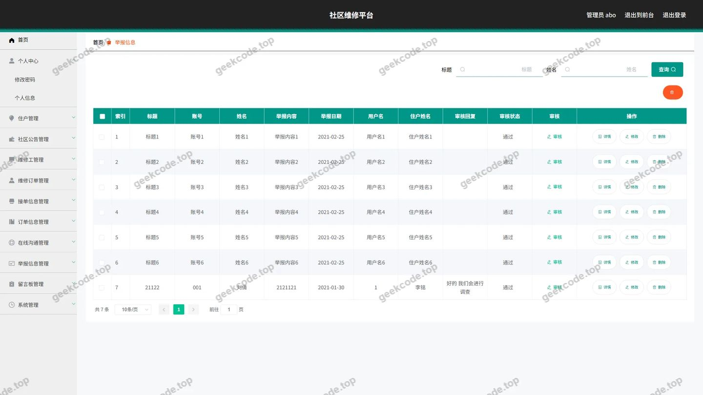</a>

<h4>后台-登录</h4>

<a href="https://geekcode.top/archives/%E7%A4%BE%E5%8C%BA%E7%BB%B4%E4%BF%AE%E5%B9%B3%E5%8F%B0?utm_source=github" title="查看完整源码">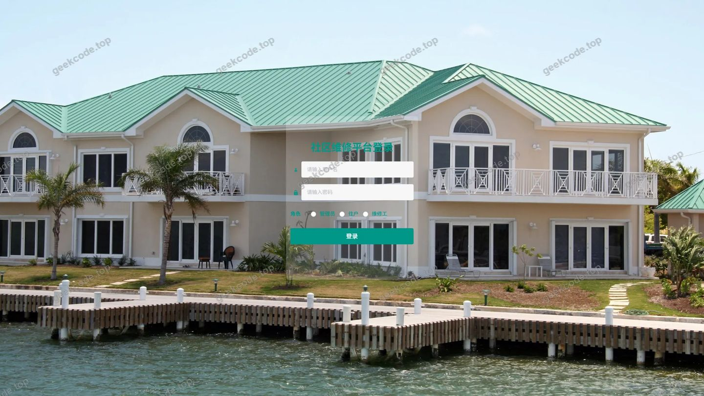</a>

<h4>后台-留言板</h4>

<h4>后台-公告信息</h4>

<a href="https://geekcode.top/archives/%E7%A4%BE%E5%8C%BA%E7%BB%B4%E4%BF%AE%E5%B9%B3%E5%8F%B0?utm_source=github" title="查看完整源码">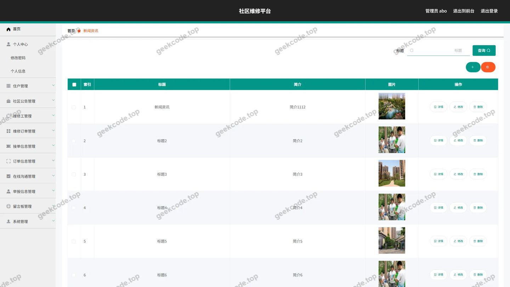</a>

<h4>后台-社区公告</h4>

<a href="https://geekcode.top/archives/%E7%A4%BE%E5%8C%BA%E7%BB%B4%E4%BF%AE%E5%B9%B3%E5%8F%B0?utm_source=github" title="查看完整源码">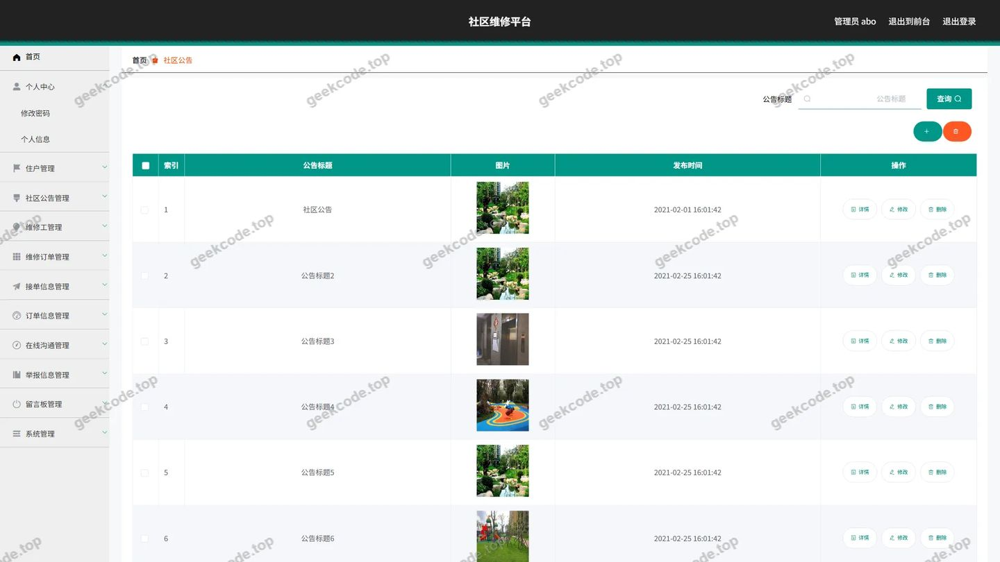</a>

<h4>后台-维修订单</h4>

<a href="https://geekcode.top/archives/%E7%A4%BE%E5%8C%BA%E7%BB%B4%E4%BF%AE%E5%B9%B3%E5%8F%B0?utm_source=github" title="查看完整源码">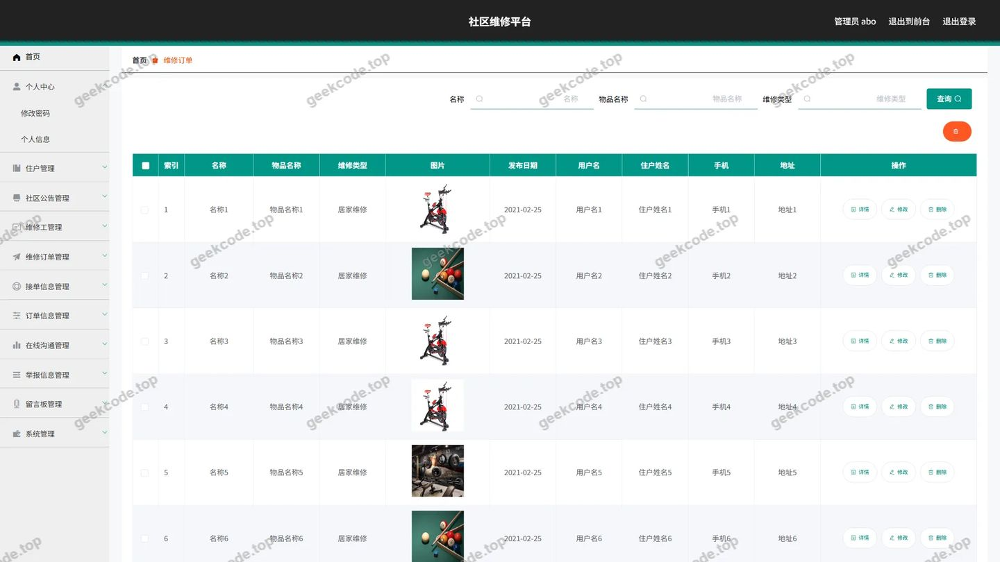</a>

<h4>后台-维修工</h4>

<a href="https://geekcode.top/archives/%E7%A4%BE%E5%8C%BA%E7%BB%B4%E4%BF%AE%E5%B9%B3%E5%8F%B0?utm_source=github" title="查看完整源码">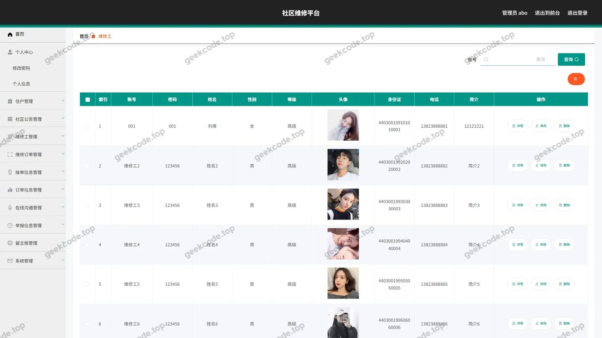</a>

<h4>后台-在线沟通</h4>

<a href="https://geekcode.top/archives/%E7%A4%BE%E5%8C%BA%E7%BB%B4%E4%BF%AE%E5%B9%B3%E5%8F%B0?utm_source=github" title="查看完整源码">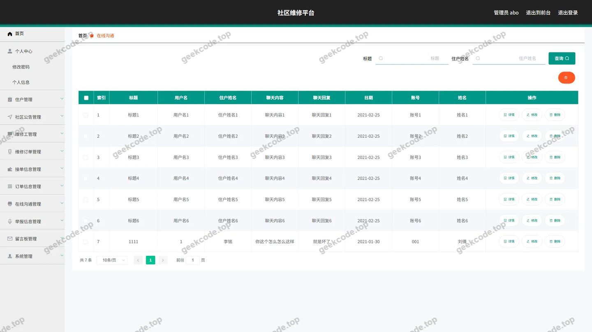</a>

<h4>后台-住户</h4>

<a href="https://geekcode.top/archives/%E7%A4%BE%E5%8C%BA%E7%BB%B4%E4%BF%AE%E5%B9%B3%E5%8F%B0?utm_source=github" title="查看完整源码">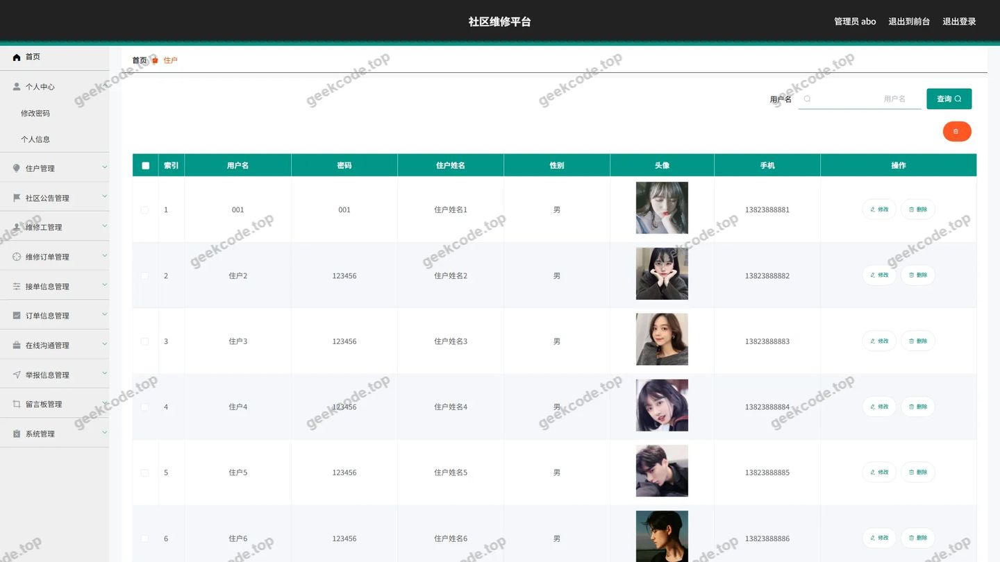</a>

---

## 获取完整源码

| 项目 | 说明 |
| --- | --- |
| 项目名 | 社区维修平台 |
| 运行截图 | 本文 18 张（站点带水印原图，仓库 `images/` 目录） |
| 完整源码 | [https://geekcode.top/archives/%E7%A4%BE%E5%8C%BA%E7%BB%B4%E4%BF%AE%E5%B9%B3%E5%8F%B0?utm_source=github](https://geekcode.top/archives/%E7%A4%BE%E5%8C%BA%E7%BB%B4%E4%BF%AE%E5%B9%B3%E5%8F%B0?utm_source=github) |
| 咨询微信 | **ir9372**（备注：jingpin-yuanma） |
| 更多项目 | [极客代码 geekcode.top](https://geekcode.top/?utm_source=github) |

> 需要源码、部署、改配置、跑不起来等问题，加微信 ir9372 沟通，说明项目名即可。
